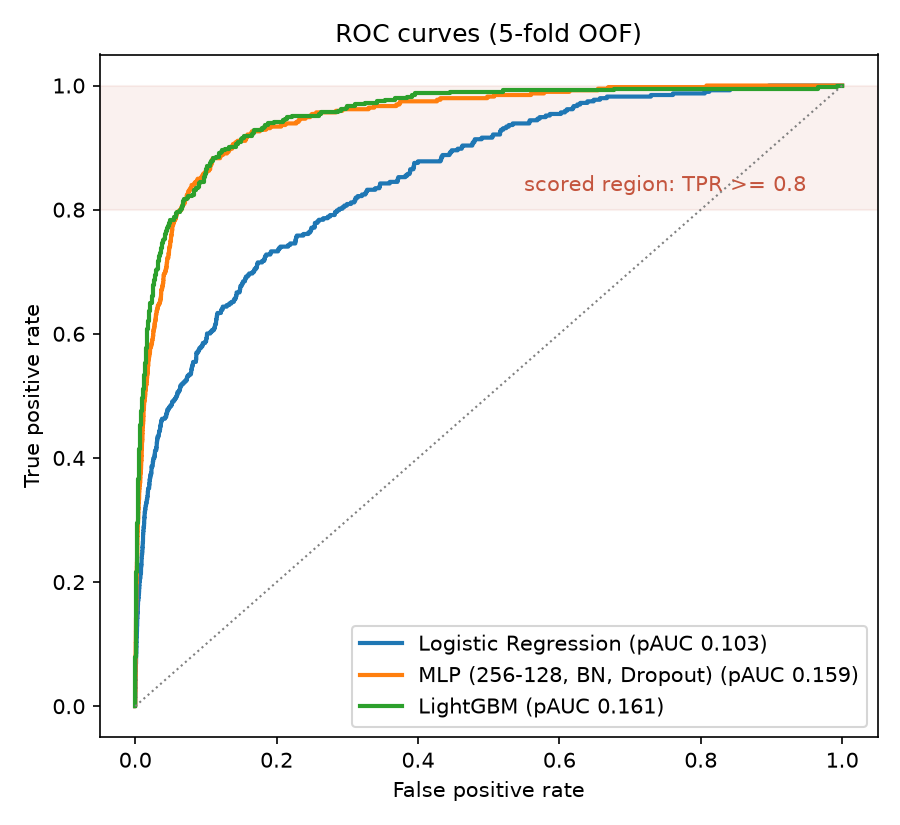
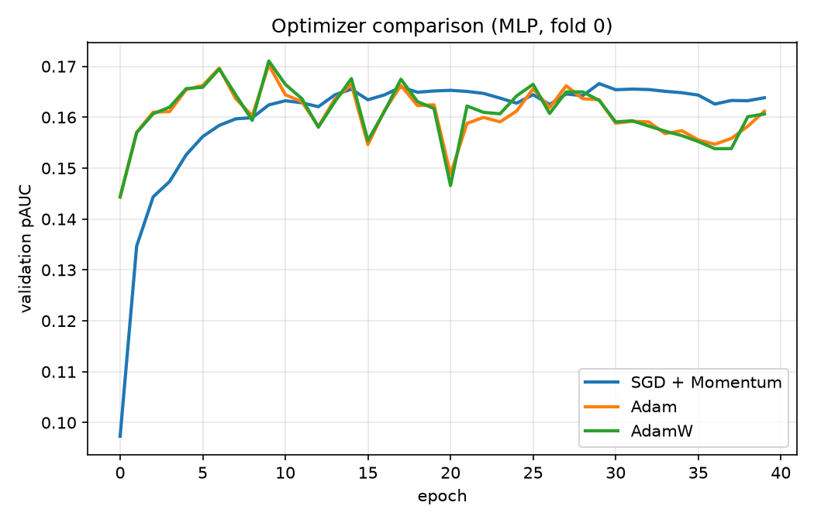
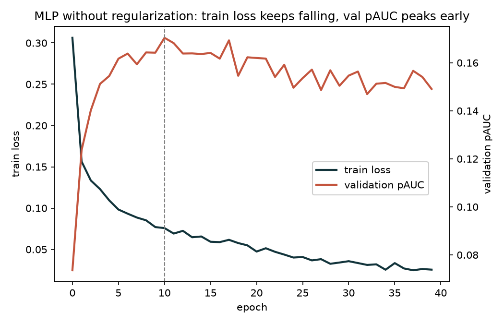

# ISIC 2024 皮膚癌偵測

深度學習期末專題。競賽：[ISIC 2024 - Skin Cancer Detection with 3D-TBP](https://www.kaggle.com/competitions/isic-2024-challenge)

給電腦看一張皮膚上痣或斑點的照片，加上病人的基本資料，讓它判斷這顆是不是皮膚癌。

## 題目

從 3D 全身攝影裁下的皮膚病灶小圖和病人資料，判斷每顆病灶是不是**惡性**，輸出機率。

| | |
|---|---|
| 任務 | 二元分類 |
| 評分 | **pAUC（TPR ≥ 80%）**：只算 ROC 曲線在高敏感度那段的面積，範圍 0–0.2，亂猜約 0.02 |
| 資料 | 401,059 張圖，惡性只有 **393 張（0.098%）**，1,042 位病人 |
| 繳交 | Code Competition，要在 Kaggle Notebook 上跑出 `submission.csv`；比賽已結束，可 Late Submission |

## 模型規劃

以深度學習為主軸、LightGBM 為強對照組，模型選擇對應課程內容：

| 資料 | 模型 | 對應課程 | 狀態 |
|---|---|---|---|
| 表格 | Logistic Regression（＝單層感知器 + sigmoid） | W1 Perceptron | ✅ 0.103 |
| 表格 | **MLP**（256-128，BatchNorm、Dropout、ReLU） | W1 MLP、W6 BN/Dropout | ✅ **0.159** |
| 表格 | LightGBM（對照組） | — | ✅ 0.161 |
| 圖片 | Simple CNN（自己搭的 Conv-BN-ReLU-MaxPool ×4） | W5 CNN | 程式完成，待 GPU |
| 圖片 | ResNet-18（ImageNet 預訓練） | W5 Advanced CNNs | 程式完成，待 GPU |
| 圖片 | EfficientNet-B0（ImageNet 預訓練） | 延伸 | 程式完成，待 GPU |
| 圖片 | ViT-Tiny（ImageNet 預訓練） | W8 Vision Transformer | 程式完成，待 GPU |
| 融合 | Stacking：圖片模型預測當 LightGBM 特徵 | — | 程式完成，待 GPU |
| 融合 | 多模態網路：CNN 分支 + MLP 分支端到端訓練 | W5 + W1 | 程式完成，待 GPU |

**共同設定**：BCEWithLogitsLoss（W4）、AdamW（W6）、每個 epoch 重新抽樣良性（處理不平衡）、
以驗證 pAUC 做 Early Stopping（W6）、所有模型共用同一種按病人分組的 5 折切分（`src/features.py: make_folds`）。

## 目前結果（5 折 OOF pAUC，上限 0.2）

| 模型 | pAUC |
|---|---|
| Logistic Regression | 0.103 |
| MLP | 0.159 |
| LightGBM | **0.161** |



**消融實驗（MLP，`python src/train_mlp.py --ablation`）**

| 實驗 | 設定 | pAUC |
|---|---|---|
| 優化器 | SGD + Momentum / Adam / AdamW | 0.158 / 0.150 / 0.154 |
| 正則化 | 無 / 只有 Dropout / 只有 BN / BN + Dropout | 0.154 / 0.153 / 0.150 / 0.154 |

<p>


</p>

**發現**
- 線性模型明顯不夠（0.103），特徵之間需要非線性組合；MLP 與 LightGBM 幾乎一樣
- Adam / AdamW 收斂快（約 5–10 epoch 達到最高），之後驗證分數下滑並震盪；SGD + Momentum 收斂慢但比較穩定
- 不加正則化時 train loss 持續下降、驗證 pAUC 約第 10 epoch 後開始下滑 → 典型 overfitting，所以需要 early stopping
- 正樣本只有 393 個，LightGBM 加 `scale_pos_weight=10` 反而掉到 0.031；模型要小、要正則化
- 病人內標準化特徵（這顆痣和同一人其他痣比有多特別）在每個模型都有幫助

## 怎麼跑

**在 Kaggle 上**（比賽頁 → Code → New Notebook → File → Import Notebook）：

| Notebook | 設定 | 用途 |
|---|---|---|
| `isic2024_baseline.ipynb` | CPU，Internet 關 | metadata baseline、EDA 圖，可直接提交 |
| `isic2024_image_models.ipynb` | **GPU，Internet 開** | 改 `CFG['model']` 切換 4 種圖片模型，每種存一個版本 |
| `isic2024_multimodal.ipynb` | **GPU，Internet 開** | 多模態網路（實驗比較用） |
| `isic2024_submission.ipynb` | **GPU，Internet 關** | Add Input 加入圖片模型的輸出（自動偵測），融合後提交 |

**在自己電腦上**：

```bash
pip install -r requirements.txt
python src/download_data.py         # 從 ISIC 官網下載 metadata（約 90 MB，不用 Kaggle 帳號）
python src/eda.py                   # 資料分析 → reports/
python src/train_lgbm.py            # LightGBM 5 折，約 10 秒
python src/train_mlp.py             # Logistic Regression + MLP 5 折（需要 PyTorch），約 30 秒
python src/train_mlp.py --ablation  # 再加優化器、正則化消融實驗，約 4 分鐘
```

## 檔案

```
notebooks/isic2024_baseline.ipynb       metadata baseline + EDA 圖
notebooks/isic2024_image_models.ipynb   圖片模型：SimpleCNN / ResNet-18 / EfficientNet-B0 / ViT-Tiny
notebooks/isic2024_multimodal.ipynb     多模態網路（CNN + MLP）
notebooks/isic2024_submission.ipynb     LightGBM + 圖片模型特徵，最終提交
src/config.py                           路徑與參數
src/download_data.py                    下載資料
src/eda.py                              資料分析
src/features.py                         特徵工程、共用的 5 折切分
src/metric.py                           官方 pAUC 評分
src/train_lgbm.py                       LightGBM
src/train_mlp.py                        Logistic Regression、MLP、消融實驗、ROC 圖
figures/                                實驗結果圖
report/書面報告_草稿.md                   W17 書面報告草稿
report/分工與時程.md                      每個人的工作與期限
```

## 分工

每人主責一個流程，每個階段都有任務。每週詳細進度見 [report/分工與時程.md](report/分工與時程.md)。

| 組員 | 主責流程 | 模型 / 實驗 | 相關程式 |
|---|---|---|---|
| [組員 A] | ① 資料分析 | EDA、圖片 EDA、CNN 錯誤案例分析 | `src/eda.py` |
| [組員 B] | ② 驗證與評分 | pAUC、ROC 比較、優化器與 BN/Dropout 消融 | `src/metric.py`、`src/train_mlp.py --ablation` |
| [組員 C] | ③ 表格模型 | Logistic Regression、MLP、LightGBM；ResNet-18 | `src/train_mlp.py`、`src/train_lgbm.py`、`src/features.py` |
| [組員 D] | ④ 圖片模型 | SimpleCNN、EfficientNet-B0、ViT-Tiny | `isic2024_image_models.ipynb` |
| [組員 E] | ⑤ 融合與提交 | 多模態網路、Stacking、Kaggle 提交 | `isic2024_multimodal.ipynb`、`isic2024_submission.ipynb` |

### 每週進度（誰、什麼時候、做好什麼）

| 週次 | A 資料分析 | B 驗證與評分 | C 表格模型 | D 圖片模型 | E 融合與提交 |
|---|---|---|---|---|---|
| **W11** | 讀懂 EDA 程式 | 讀懂 pAUC 與按病人切 fold | 本機重跑表格模型、確認結果 | 讀懂圖片模型 notebook | Kaggle 提交 baseline，拿到分數 |
| **W12 報告** | 資料長相、資料分析頁 | 任務與評分頁 | 方法、初步結果頁 | 圖片模型規劃 | 分工頁、整合簡報、繳交 PPT |
| **W13** | 圖片 EDA | 圖片模型優化器比較 | Kaggle 跑 ResNet-18；MLP 調參 | 跑 SimpleCNN、EfficientNet-B0 | 跑多模態網路 |
| **W14 報告** | CNN 錯誤案例分析 | 全部模型 ROC 比較圖 | 融合後特徵重要度 | 跑 ViT-Tiny；圖片模型比較表 | 融合比較並提交；整合 10 頁簡報 |
| **W15 交程式、口試** | 整理全組實驗圖表 | 融合門檻分析 | 口試：表格模型 | 改進最好的圖片模型 | 最終提交、GitHub 定版 |
| **W16 口試** | 準備口試 | 準備口試 | 準備口試 | 準備口試 | 準備口試 |
| **W17 書面報告** | 第 2、3 章，整合全文 | 1.2、4.1 節、消融實驗 | 4.2、4.3、5.1 節 | 4.4、5.2 節 | 4.5 節、第 6、7 章 |

每次跑完實驗，照 [report/分工與時程.md](report/分工與時程.md) 的回報格式貼到群組。

## 資料來源

- SLICE-3D 資料集，DOI [10.34970/2024-slice-3d](https://doi.org/10.34970/2024-slice-3d)，CC-BY-NC 4.0
- 資料集論文：[Scientific Data, 10.1038/s41597-024-03743-w](https://doi.org/10.1038/s41597-024-03743-w)
