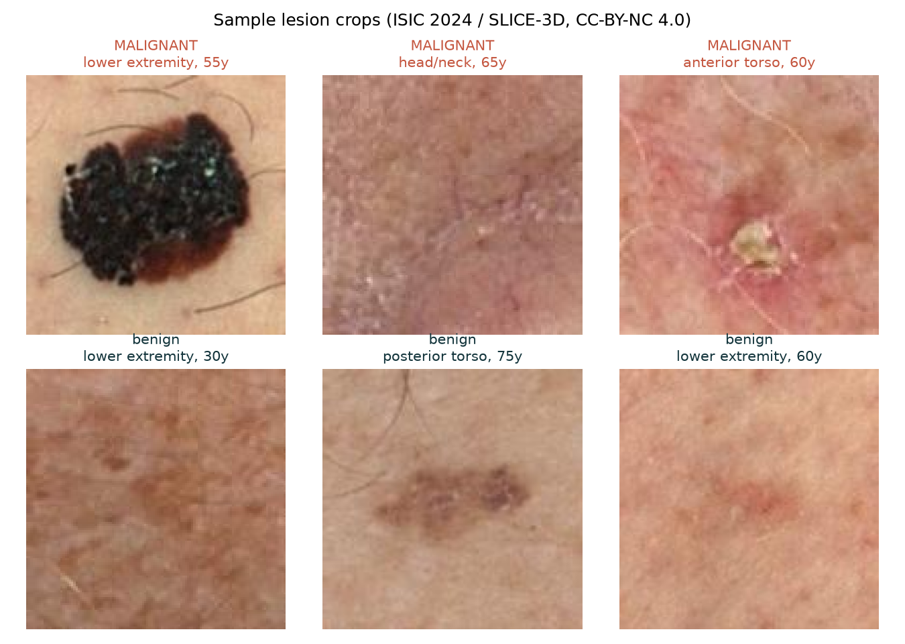
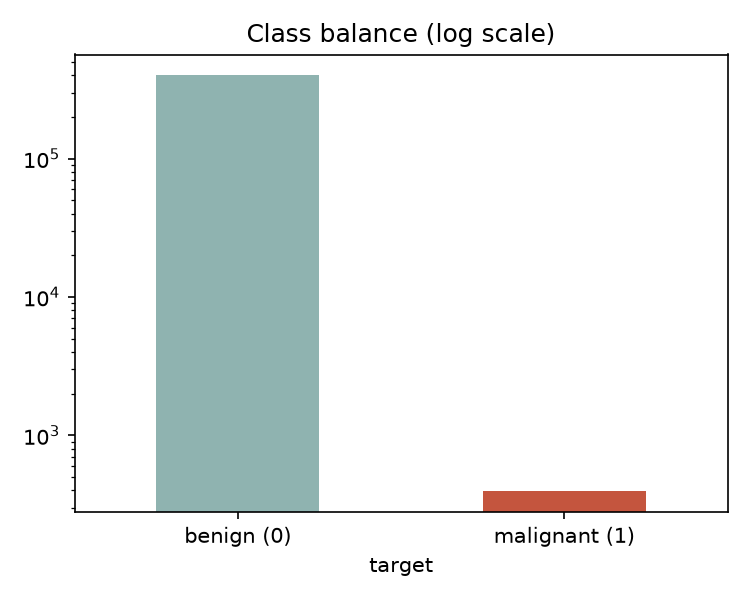
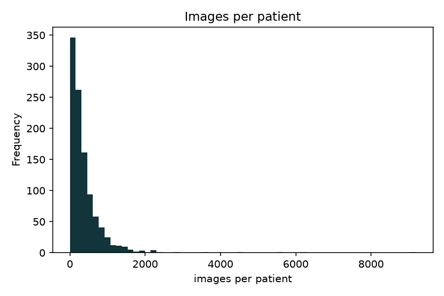
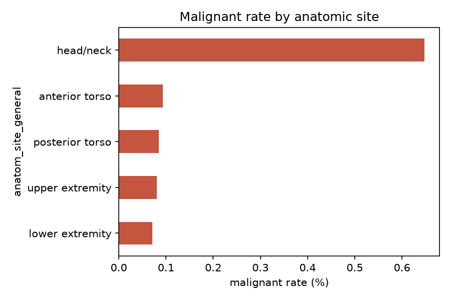
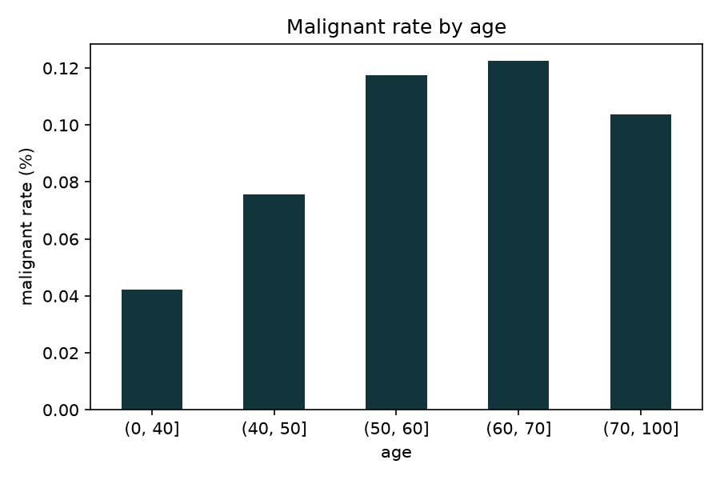
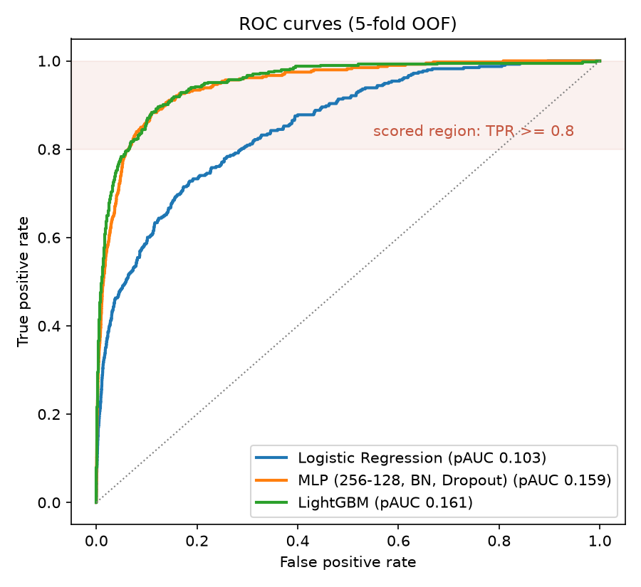
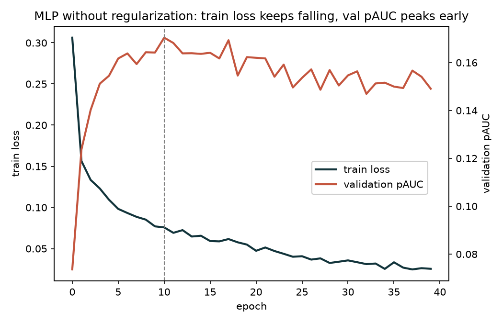

# 02 模型與實驗

| 章節 | 內容 |
|---|---|
| [一、專題整體流程](#一專題整體流程) | 從了解資料到最終提交，整學期分成 7 個階段 |
| [二、單次實驗怎麼跑](#二單次實驗怎麼跑) | 每一個實驗內部的流程（讀資料 → 訓練 → 評估 → 輸出） |
| [三、實驗設計](#三實驗設計) | 共同基準 BASE、五個變因 |
| [四、模型與設定](#四模型與設定) | baseline 怎麼選、模型清單、訓練設定 |
| [五、結果](#五結果) | 依階段整理的結果 |
| [六、發現](#六發現) | 目前可以下的結論 |
---

## 一、專題整體流程

```
階段 1  了解資料（EDA）                         W10–W11  ✅
   │      找出不平衡、按病人切、重要特徵
   ▼
階段 2  建立驗證流程 + 表格模型 baseline        W11      ✅
   │      按病人 5 折、pAUC；LR / MLP / LightGBM；第一次 Kaggle 提交
   ▼
階段 3  Round 0 對齊：五人各跑一次 BASE         W11–W12  ⏳
   │      五個分數應該很接近 → 確認大家的環境一致
   ▼
階段 4  Round 1 變因實驗：五人同時跑             W12–W13  ⏳
   │      A 架構 ┃ B 優化器 ┃ C 正則化 ┃ D 不平衡 ┃ E 輸入與融合
   ▼
階段 5  Round 2 彙整比較                         W14      ⏳
   │      collect_results.py → 全組比較表；每個變因選出最好的設定
   ▼
階段 6  Round 3 合併最佳設定 → 最終模型          W15      ⏳
   │      FINAL = A–D 各自最好的設定合在一起
   │      再和 LightGBM 融合（Stacking），和多模態比較
   ▼
階段 7  最終提交 + 報告                          W15–W17  ⏳
          Kaggle 最終分數、程式定版、口頭報告、書面報告
```

| 階段 | 目的 | 怎麼做 | 產出 | 誰 |
|---|---|---|---|---|
| 1. 了解資料 | 知道資料的難點，決定後面的做法 | `src/eda.py`：類別分布、每人圖片數、部位與年齡、相關性 | 5 張 EDA 圖、5 個發現（見 5.1） | 已完成 |
| 2. 驗證流程 + baseline | 建立所有模型共用的評估方式，並有第一個分數 | 按病人分組 5 折、官方 pAUC；先跑 LightGBM，再加 LR、MLP 比較 | 表格模型結果、Kaggle private 0.149（見 5.2） | 已完成 |
| 3. Round 0 對齊 | 確認每個人的 Kaggle 環境與流程一致 | 每人跑 `EXP = 'BASE'` | 五個 BASE 分數 | 全部 |
| 4. Round 1 變因實驗 | 每個變因各自找出最好的設定 | 每人跑自己的編號（只改一個設定） | 每個實驗一份 `exp_XX.json` | A–E 同時 |
| 5. Round 2 彙整 | 把所有實驗放進同一張表比較 | `exp_XX.json` 放進 `results/`，`python src/collect_results.py` | `results/summary.md`、W14 簡報 | 全部 |
| 6. Round 3 合併 | 組出最終模型 | 在 notebook 的 `FINAL` 填入 A–D 各自最好的設定 → 跑 `EXP = 'FINAL'`；再用 `isic2024_submission` 和 LightGBM 融合，並和多模態（E4）比較 | 最終模型與分數 | E 主導 |
| 7. 最終提交 + 報告 | 交出成果 | 提交分數最好的版本；整理圖表與報告 | Kaggle 最終分數、書面報告 | 全部 |

**階段 6 怎麼合併**：例如 5.4 的比較表顯示 A 組 ResNet-18 最好、B 組 SGD 最好、C 組強增強最好、D 組 Focal loss 最好，就在 `isic2024_image_models.ipynb` 的 `EXPERIMENTS` 裡把

```python
'FINAL': ('全部', '合併最佳設定', dict()),
```

改成

```python
'FINAL': ('全部', '合併最佳設定', dict(model='resnet18', optimizer='sgd', lr=1e-2, aug='strong', loss='focal')),
```

再跑 `EXP = 'FINAL'`。合併後不一定比單一改動好（變因之間可能互相影響），所以 FINAL 也要跟 BASE 比較，最後以分數決定提交哪一個。

---

## 二、單次實驗怎麼跑

上面每個階段裡的每一個實驗，都跑下面這條流程；不同實驗之間**只差一個設定**（見「三、實驗設計」）。

```
                ┌──────────────────────── 原始資料 ────────────────────────┐
                │ train-metadata.csv（每張圖一列：年齡、部位、大小、顏色…）   │
                │ train-image.hdf5（40 萬張病灶小圖）                        │
                └──────────────┬──────────────────────────┬────────────────┘
                               │                          │
                     ① 特徵工程（表格）              ② 影像前處理
                     原始欄位 + 病人內標準化          縮放 128px、資料增強
                               │                          │
                ③ 按病人分組切 5 折（所有模型共用同一種切法）
                               │                          │
              ┌────────────────┼──────────────┐           │
              ▼                ▼              ▼           ▼
        Logistic Reg.        MLP          LightGBM     CNN / ResNet /
                                          （對照組）   EfficientNet / ViT
              └────────────────┴──────┬───────┘           │
                                      │      ⑤ 多模態網路（圖片 + 表格一起訓練）
                                      │                   │
                         ④ 每個模型都產生 OOF 預測 → 算 pAUC、互相比較
                                      │
                         ⑥ Stacking：圖片模型的預測當成 LightGBM 的新特徵
                                      │
                         ⑦ Kaggle 提交：測試集預測 → submission.csv → 分數
```

### ① 讀資料、建表格特徵（`src/features.py`）

- 讀 `train-metadata.csv`，**只保留 train 和 test 都有的欄位**；`iddx_*`（病理診斷）這類只有 train 才有、等於寫出答案的欄位全部排除，避免資料洩漏
- **原始特徵 39 個**：年齡、性別、身體部位、病灶大小，以及 30 多個 3D-TBP 系統算出的顏色、形狀、對比數值
- **病人內標準化 30 個**：每個數值特徵減掉「同一位病人所有病灶的平均」、再除以標準差 → 代表「這顆痣跟這個人其他痣比有多不一樣」（醫生的醜小鴨判斷法）
- **病人病灶數 1 個**：這個人總共被拍了幾顆
- 共 **70 個特徵**。給神經網路用時再做：缺失值補中位數、標準化、類別欄位 one-hot → **108 維**

### ② 影像前處理（`isic2024_image_models.ipynb`）

- 從 hdf5 讀出 JPEG → 縮放成 128 × 128 → 用 ImageNet 的平均值與標準差正規化
- **訓練時才做資料增強**：水平／垂直翻轉、旋轉、色彩抖動（皮膚病灶沒有固定方向，翻轉後答案不變）
- 驗證、測試時不增強

### ③ 切驗證集（`make_folds`）

- `StratifiedGroupKFold`，5 折，`random_state=42`
- **按 `patient_id` 分組**：同一位病人的所有圖只會在同一折。每人中位數 242 張圖，若隨機切，模型會在驗證時「認得」這個人，分數虛高
- **按 target 分層**：每一折的惡性比例差不多
- **所有模型用完全相同的切法**，結果才能直接比較，融合時也不會洩漏

### ④ 訓練與評估（神經網路的流程）

```
for 每一折 k = 0..4:
    用其他 4 折訓練
        每個 epoch：全部惡性 + 重新隨機抽「惡性 × 20」張良性    ← 處理不平衡
        每個 epoch 結束：在第 k 折算 pAUC，連續沒進步就停       ← early stopping
    用最好的那個 epoch 預測第 k 折                             ← 這就是 OOF 預測
把 5 折的 OOF 預測合起來 → 算整體 pAUC
```

細節差異：
- **MLP**：每個 epoch 在整個第 k 折算 pAUC，連續 6 個 epoch 沒進步就停
- **圖片模型**：為了省時間，每個 epoch 只在「第 k 折的全部惡性 + 隨機 20,000 張良性」上算 pAUC，連續 3 個 epoch 沒進步就停（最多 10 個）；停下後再用最佳權重預測整個第 k 折
- **LightGBM** 沒有 epoch：每折抽一次樣（良性 = 惡性 × 50），固定 200 棵樹

- **OOF（out-of-fold）預測**：每一筆訓練資料都有一個「由沒看過它的模型」給出的預測，等於用全部 40 萬筆做驗證
- **評分**：官方 pAUC，只算 ROC 曲線在 TPR ≥ 0.8 的面積（`src/metric.py`）
- **損失函數**：BCEWithLogitsLoss（sigmoid + binary cross-entropy）；D 組另外比較 pos_weight、Focal loss
- **優化器**：AdamW + Cosine 學習率；B 組另外比較 SGD、Adam 與不同學習率
- 每次實驗輸出 `exp_XX.json`（設定 + 分數）和 `oof_XX.csv`（每筆的預測）

| 模型類型 | 在哪裡跑 | 程式 | 時間 |
|---|---|---|---|
| Logistic Regression、MLP | 本機 CPU | `src/train_mlp.py` | 約 30 秒 |
| LightGBM | 本機 CPU 或 Kaggle | `src/train_lgbm.py`、`isic2024_baseline` | 約 10 秒 |
| 圖片模型 | Kaggle GPU | `isic2024_image_models` | 預估 30–60 分鐘 |
| 多模態網路 | Kaggle GPU | `isic2024_multimodal` | 預估 30–60 分鐘 |

### ⑤ 多模態網路（`isic2024_multimodal.ipynb`）

一個網路同時看圖片和表格：圖片經 CNN 骨幹得到特徵向量，表格經兩層 MLP 得到 64 維向量，兩者串接後接全連接層輸出機率。**兩個分支一起反向傳播**，切法、抽樣、early stopping 與上面相同。

### ⑥ Stacking 融合（`isic2024_submission.ipynb`）

- 把每個圖片模型的 **OOF 預測**，以及「這張圖在同一病人裡的可疑程度排名」，加進 LightGBM 當新特徵，再跑一次 5 折
- 必須用 OOF 預測：如果用模型看過的資料的預測，LightGBM 會學到「偷看答案」的特徵
- 同時印出「只用表格」「加單一圖片模型」「加全部圖片模型」的分數比較

### ⑦ Kaggle 提交

- Code Competition：提交的 notebook 必須**關閉網路**，Kaggle 會用隱藏的測試集重跑
- 測試集的圖片特徵 = 5 個 fold 的圖片模型預測取平均；LightGBM 也是 5 個 fold 模型平均
- 輸出 `submission.csv`（`isic_id, target`），Kaggle 回傳 public / private 分數
- 目前已提交 LightGBM：**private 0.149 / public 0.171**（本地 CV 0.161）

---

## 三、實驗設計

每個實驗 = 共同基準 `BASE` ＋ 只改一個變因，五個變因各由一位組員負責（編號見 [03_分工與時程](03_分工與時程.md#實驗編號一覽)）。

| 變因 | 負責 | 比較的選項（粗體 = BASE） |
|---|---|---|
| 模型架構 | A | Simple CNN / ResNet-18 / **EfficientNet-B0** / ViT-Tiny |
| 優化器與學習率 | B | SGD+Momentum / Adam / **AdamW**；lr 1e-4 / **3e-4** / 1e-3 |
| 正則化與資料增強 | C | 無 / **基本** / 強增強；Dropout **0.3** / 0 |
| 不平衡處理 | D | 抽樣 1:5 / **1:20** / 1:50；**BCE** / pos_weight / Focal loss |
| 輸入資料與融合 | E | 只用表格 / **只用圖片** / Stacking / 多模態 |

**BASE**：EfficientNet-B0、128px、AdamW lr 3e-4、基本增強、Dropout 0.3、良性抽樣 1:20、BCE loss、early stopping。

---

## 四、模型與設定

### 4.1 Baseline 怎麼選的

**表格：LightGBM（先做，後來當對照組）**

1. **最快拿到可信的分數**：只用 metadata、CPU 約 10 秒完成 5 折
2. **先把驗證流程做對**：按病人切 fold、pAUC、排除洩漏欄位；用最快的模型先確認流程，之後換模型才有共同基準
3. **表格資料的強基準**：梯度提升樹通常是表格資料最強的一類；本比賽公開方案也以 GBDT 處理 metadata
4. **轉為對照組**：本課程以深度學習為主，LightGBM 用來衡量神經網路的表現

另以 **Logistic Regression** 當最低基準線，確認需要非線性模型。

**圖片：BASE 用 EfficientNet-B0**

1. **準確度與大小平衡**：4.0M 參數（ResNet-18 為 11.2M），ImageNet 表現較好，Kaggle 免費 GPU 跑得完
2. **適合小圖**：病灶圖只有一百多像素
3. **ISIC 系列比賽常用**
4. **其他設定取常見中間值**，讓每個變因能往兩邊比較

BASE 是依常見做法先選定的起點，不代表最佳；A1–A3 的架構比較就是在檢驗這個選擇。

### 4.2 模型清單

| 資料 | 模型 | 結構 | 參數量 | 對應課程 | 程式 |
|---|---|---|---|---|---|
| 表格 | Logistic Regression | Linear → sigmoid（單層感知器） | — | W1 | `src/train_mlp.py` |
| 表格 | MLP | 256 → 128，BN、ReLU、Dropout | — | W1、W6 | `src/train_mlp.py` |
| 表格 | LightGBM（對照組） | 15 葉、200 棵樹、正則化 | — | — | `src/train_lgbm.py` |
| 圖片 | Simple CNN | [Conv-BN-ReLU ×2 → MaxPool] ×4 | 1.2M | W5 | `isic2024_image_models` |
| 圖片 | ResNet-18 | 殘差連接，ImageNet 預訓練 | 11.2M | W5 | 同上 |
| 圖片 | EfficientNet-B0 | ImageNet 預訓練 | 4.0M | 延伸 | 同上 |
| 圖片 | ViT-Tiny | 16×16 patch、self-attention | 5.5M | W8 | 同上 |
| 融合 | Stacking | 圖片 OOF 預測 → LightGBM 特徵 | — | — | `isic2024_submission` |
| 融合 | 多模態網路 | CNN 分支 + MLP 分支端到端 | — | W5 + W1 | `isic2024_multimodal` |

### 4.3 訓練設定與課程對應

| 項目 | 做法 | 對應課程 |
|---|---|---|
| 損失函數 | BCEWithLogitsLoss（sigmoid + binary cross-entropy） | W4 |
| 優化器 | AdamW + Cosine 學習率 | W3、W6 |
| mini-batch | 表格 256、圖片 128 | W3 |
| 不平衡 | 每個 epoch 全部惡性 + 重新抽樣良性（20 倍；LightGBM 50 倍） | — |
| 防過擬合 | Early Stopping、BatchNorm、Dropout、資料增強 | W6 |
| 推論 | `model.eval()`：BN 用累積統計量、Dropout 關閉 | W6 |

---

## 五、結果

所有分數都是 **5 折 OOF pAUC**（上限 0.2，亂猜約 0.02），除非另外註明。

### 5.0 總覽

| 流程階段 | 實驗 | 結果 | 狀態 |
|---|---|---|---|
| 1. 了解資料 | EDA（5 張圖） | 見 5.1 | ✅ |
| 2. baseline | Logistic Regression | 0.103 | ✅ |
| 2. baseline | MLP | 0.159 | ✅ |
| 2. baseline | LightGBM | **0.161** | ✅ |
| 2. baseline | Kaggle 提交（LightGBM） | private **0.149** / public 0.171 | ✅ |
| 2. baseline | MLP 先導消融（優化器、正則化） | 0.150–0.158 | ✅ |
| 3. Round 0 | BASE × 5 人 | — | ⏳ |
| 4. Round 1 | A1–A3 架構 | — | ⏳ |
| 4. Round 1 | B1–B4、C1–C4、D1–D4 | — | ⏳ |
| 4. Round 1 | E3 Stacking、E4 多模態 | — | ⏳ |
| 5. Round 2 | 全組比較表 | — | ⏳ |
| 6. Round 3 | FINAL（合併最佳設定）＋融合 | — | ⏳ |
| 7. 最終提交 | Kaggle 最終分數 | — | ⏳ |

### 5.1 資料分析

圖由 `python src/eda.py` 產生（完整 401,059 筆）。



<p>



</p>
<p>


</p>

| 發現 | 數字 | 對建模的意義 |
|---|---|---|
| 極度不平衡 | 惡性 393 / 401,059（0.098%） | 抽樣處理不平衡、用 pAUC 評估 |
| 同一人圖很多 | 每人中位數 242 張，最多 9,184 張 | 驗證集按病人切 |
| 頭頸部特別高 | 0.648%，其他部位 0.07–0.09% | 部位是重要特徵 |
| 年紀越大越高 | 40 歲以下 0.04%，60–70 歲 0.12% | 年齡是重要特徵 |
| 單一特徵有訊號但不夠 | 相關係數最高僅 0.045（惡性只佔 0.1%，相關係數會被壓得很小）；改看單一特徵 AUC，最好的色相 H 有 0.81，但 pAUC 只有 0.077 | 組合 70 個特徵的 LightGBM 達 pAUC 0.161（約 2 倍）→ 需要模型組合特徵 |

#### 為什麼需要模型：單一特徵 vs 組合

**要抓到 80% 的惡性（393 顆中的 314 顆）時，會誤判多少良性？**

| 方法 | 被誤判成惡性的良性病灶 |
|---|---|
| 只看「大小」 | **99.6%（約 39.9 萬顆）**，等於全部都判惡性 |
| 只看「色相 H」（最好的單一特徵） | 36.8%（約 14.8 萬顆） |
| **模型組合 70 個特徵（LightGBM）** | **6.5%（約 2.6 萬顆）** |

- **單一欄位判斷不了**：只用一個欄位設門檻，想抓到大部分癌症就得把一大堆良性也判成惡性
- **組合多個特徵**：每條線索單獨都很弱，同時符合好幾條的病灶才明顯可疑；模型學會每條線索的權重，誤判從 37% 降到 6.5%

白話完整說明見 [00_專題說明：為什麼一定要用模型](00_專題說明.md#為什麼一定要用模型)。

### 5.2 表格模型

| 模型 | OOF pAUC | 各折 |
|---|---|---|
| Logistic Regression | 0.103 | 0.152 / 0.128 / 0.148 / 0.107 / 0.115 |
| MLP | 0.159 | 0.171 / 0.143 / 0.168 / 0.171 / 0.144 |
| LightGBM | **0.161** | 0.171 / 0.145 / 0.169 / 0.174 / 0.151 |

**Kaggle 實際提交（LightGBM）**：private **0.149**、public 0.171。與本地 CV 0.161 接近，代表按病人切的驗證方式可靠。



**LightGBM 設定演進**（參數怎麼決定的）

| 設定 | pAUC |
|---|---|
| 大模型 + `scale_pos_weight=10` | 0.031 |
| 大模型，不加權 | 0.129 |
| 小模型 + 正則化 | 0.156 |
| + 良性抽樣 1:50 | 0.156 |
| + 病人內標準化特徵 | **0.161** |

### 5.3 消融實驗（MLP 先導實驗）

設定：固定 40 epochs、每折取驗證分數最好的 epoch（和 5.2 的 MLP 用 early stopping 不同，數字不能直接比）。圖片模型上的正式比較見 5.4（B、C 組）。

| 實驗 | 設定 | OOF pAUC |
|---|---|---|
| 優化器 | SGD + Momentum | **0.158** |
| | Adam | 0.150 |
| | AdamW | 0.154 |
| 正則化 | 無 BN、無 Dropout | **0.154** |
| | 只有 Dropout | 0.153 |
| | 只有 BN | 0.150 |
| | BN + Dropout | **0.154** |

<p>


</p>

### 5.4 Round 1–3：圖片模型、融合與最終模型（待 Kaggle GPU）

各人跑完後放進 `results/`，執行 `python src/collect_results.py`，全組比較表會自動產生在 [results/summary.md](../results/summary.md)。

| 變因 | 實驗 | OOF pAUC | 與 BASE 差 |
|---|---|---|---|
| 基準 | BASE | | — |
| 模型架構 | A1 Simple CNN / A2 ResNet-18 / A3 ViT-Tiny | | |
| 優化器與學習率 | B1 SGD / B2 Adam / B3 lr 1e-3 / B4 lr 1e-4 | | |
| 正則化與增強 | C1 無增強 / C2 強增強 / C3 無 Dropout / C4 強增強＋無 Dropout | | |
| 不平衡處理 | D1 1:5 / D2 1:50 / D3 pos_weight / D4 Focal | | |
| 融合 | E3 Stacking / E4 多模態 | | |
| **最終** | **FINAL（A–D 最佳設定合併）＋融合** | | |

---

## 六、發現

目前（表格模型與先導實驗）可以下的結論：

1. **線性模型不夠**：Logistic Regression 0.103，MLP 0.159 → 特徵之間需要非線性組合；MLP 與 LightGBM（0.161）幾乎一樣
2. **驗證方式可靠**：Kaggle private 0.149 與本地 CV 0.161 接近
3. **Adam 類收斂快但會過頭**：約 5–10 epoch 達到最高後下滑震盪；SGD + Momentum 慢但穩
4. **典型 overfitting**：不加正則化時 train loss 一直降，驗證 pAUC 約第 10 epoch 後下滑 → 需要 early stopping
5. **BN / Dropout 在表格 MLP 上影響不大**（0.150–0.154），差距在隨機波動範圍內
6. **正樣本太少時不要直接加權**：LightGBM 加 `scale_pos_weight=10` 掉到 0.031

> 消融實驗的差距都很小，不要說成「某個一定比較好」。

## 參考來源

- 病人內標準化概念：[isic2024 ugly duckling](https://www.kaggle.com/code/emanuele/isic2024-ugly-duckling)
- LightGBM + 圖片模型融合：[ISIC 2024 LGBM+ImageNet](https://www.kaggle.com/code/richolson/isic-2024-lgbm-imagenet-public)
- 按病人分組 5 折：[3rd Place Solution](https://www.kaggle.com/competitions/isic-2024-challenge/writeups/ks-3rd-place-solution)
