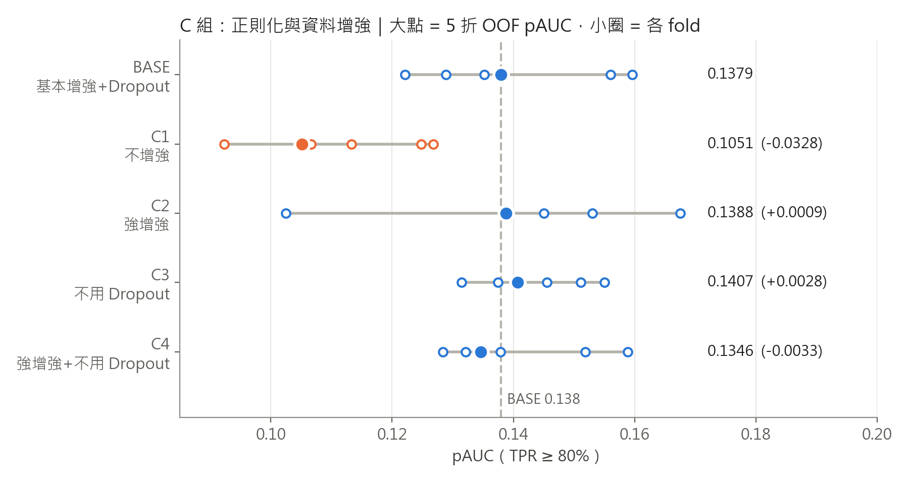
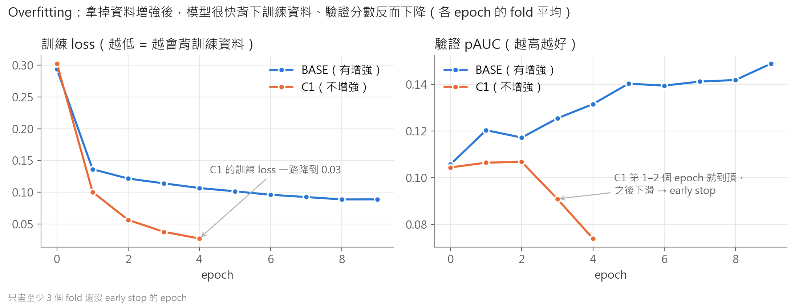

# W14 報告｜組員 C：正則化與資料增強

- 專題：ISIC 2024 皮膚癌偵測（Kaggle）
- 簡報（Canva）：[W14](https://canva.link/zdn0mil8oyhi81y)
- GitHub：<https://github.com/Raychen9678/DL_Final_Project>（結果在 `results/C/`，圖在 `figures/C/`）
- 報告長度：2 頁，約 2 分 30 秒

---

## 1. 要回答的問題

資料增強和 Dropout 能不能減少 overfitting？強增強會不會反而有害？

## 2. 實驗設計

以全組共同基準 **BASE** 為對照，每個實驗只改一項設定，其他全部相同：

- **共同設定**：EfficientNet-B0、128px、AdamW lr 3e-4、良性抽樣 1:20、BCE loss、10 epochs、early stopping（patience 3）
- **驗證方式**：按病人切的 5 折（StratifiedGroupKFold），評分用官方 pAUC（TPR ≥ 80%，範圍 0–0.2，亂猜約 0.02）
- **執行環境**：Kaggle GPU T4 x2，用 `isic2024_image_models_C_all.ipynb` 依序跑完 5 個實驗，共約 3 小時

| 編號 | 改了什麼 |
|---|---|
| BASE | 基本增強（翻轉、旋轉、色彩）＋ Dropout 0.3 |
| C1 | 不做資料增強 |
| C2 | 強增強（再加隨機裁切縮放、仿射、模糊） |
| C3 | 不用 Dropout |
| C4 | 強增強 ＋ 不用 Dropout |

## 3. 結果

| 編號 | OOF pAUC | 與 BASE 差 | 5 折中贏 BASE | 各 fold pAUC | 花費時間 |
|---|---|---|---|---|---|
| BASE | 0.1379 | — | — | 0.135 / 0.122 / 0.160 / 0.129 / 0.156 | 40 分 |
| **C1** | **0.1051** | **−0.0328** | 1/5 | 0.092 / 0.125 / 0.127 / 0.113 / 0.107 | 23 分 |
| C2 | 0.1388 | +0.0009 | 3/5 | 0.145 / 0.102 / 0.168 / 0.138 / 0.153 | 41 分 |
| C3 | 0.1407 | +0.0028 | 3/5 | 0.146 / 0.138 / 0.155 / 0.132 / 0.151 | 33 分 |
| C4 | 0.1346 | −0.0033 | 3/5 | 0.138 / 0.128 / 0.159 / 0.132 / 0.152 | 41 分 |

## 4. 結論

1. **資料增強是必要的（C1）**：拿掉增強後 pAUC 從 0.138 掉到 0.105，5 折有 4 折變差。C1 的訓練 loss 降到約 0.03（BASE 約 0.09），驗證 pAUC 在第 1–2 個 epoch 就到頂、之後下滑並提早 early stop，是典型的 overfitting。原因是惡性樣本只有約 300 張，不增強時每個 epoch 看到的都是同樣的圖，很快就被記下來。
2. **強增強沒有比基本增強更好（C2）**：只高 0.001，而且各 fold 波動最大（0.102–0.168）。C2 的訓練 loss 最高，驗證 pAUC 到第 10 個 epoch 仍在上升，可能需要更多 epoch，但這次沒有驗證。
3. **Dropout 幾乎沒有影響（C3、C4）**：差距在 ±0.003 以內，小於 fold 之間本來的波動（約 ±0.015），視為雜訊。Dropout 只加在最後一層，而預訓練骨幹加上資料增強已經提供足夠的正則化。

**W15 合併建議**：保留 `aug='basic'`；`dropout` 用 0 或 0.3 都可以，如果要選，C3（`dropout=0.0`）分數最高、各折最穩定。

---

## 5. 講稿

### 第 1 頁：資料增強不能拿掉，Dropout 影響不大（約 1 分 15 秒）

> 我負責的變因是正則化與資料增強，想回答的問題是：資料增強和 Dropout 能不能減少 overfitting？強增強會不會反而有害？
>
> 我以共同基準 BASE 為對照，也就是基本增強加上 Dropout 0.3，然後跑了四個變化：C1 完全不增強、C2 改用強增強、C3 拿掉 Dropout、C4 強增強同時拿掉 Dropout。其他設定全部和 BASE 一樣，也用同樣的 5 折切分，所以可以直接比較。
>
> 圖上的大點是 5 折合起來的 pAUC，小圈是每一折各自的分數，虛線是 BASE 的 0.138。
>
> 最明顯的是 C1：拿掉增強後分數掉到 0.105，五折裡有四折都比 BASE 差，所以資料增強是一定要做的。
>
> 另外三個實驗跟 BASE 的差距都在千分之三以內。但同一個設定在不同 fold 之間本來就會差到一、二十分之一，所以這些小差距沒辦法說誰比較好。強增強沒有比基本增強更好，Dropout 有沒有加也幾乎沒差。

### 第 2 頁：不增強 → 模型背下訓練資料，驗證分數反而下降（約 1 分 15 秒）

> 這一頁解釋為什麼不增強會變差。左邊是訓練 loss，右邊是驗證 pAUC，藍色是 BASE，橘色是不增強的 C1。
>
> 左邊可以看到，C1 的訓練 loss 掉得非常快，一路降到 0.03，BASE 只降到 0.09 左右。單看訓練資料，C1 好像學得比較好。
>
> 但右邊的驗證分數相反：BASE 從頭到尾穩定上升，C1 在第一、二個 epoch 就到頂，之後開始往下掉，很快就觸發 early stop。這就是典型的 overfitting——訓練越來越好，沒看過的資料反而越來越差。
>
> 原因跟資料有關：惡性病灶只有大約 300 張。不做增強的話，模型每個 epoch 看到的都是一模一樣的圖，很快就能記下來。加上翻轉、旋轉、色彩變化之後，每次看到的都有一點不同，模型只能去學真正的病灶特徵。
>
> 所以 W15 合併最終模型時，我建議保留基本增強；Dropout 用 0 或 0.3 都可以，如果要選，C3 不用 Dropout 的分數最高、各折也最穩定。

---

## 6. 可能被問到的問題

**Q：C3 分數最高，為什麼不說拿掉 Dropout 比較好？**
它只比 BASE 高 0.003，但同一個設定在不同 fold 之間會差到 0.03 左右，五折裡也只有三折贏。這個差距在雜訊範圍內，不能當成結論。

**Q：為什麼 Dropout 沒有效？**
Dropout 只加在最後一層分類器前面。骨幹是 ImageNet 預訓練的 EfficientNet，本身已經學好通用特徵，再加上資料增強，正則化已經足夠。

**Q：強增強為什麼沒有更好？**
強增強的訓練 loss 是五個裡最高的，代表模型比較難學；它的驗證分數到第 10 個 epoch 都還在上升，可能 10 個 epoch 不夠收斂。加長訓練也許會更好，但這次沒有驗證。它各 fold 的波動也最大。

**Q：為什麼不直接比 train loss 和 val loss 的差距？**
訓練時良性和惡性抽樣成 20:1，驗證資料大約是 900:1，兩邊 loss 的基準不同，直接相減沒有意義。所以改看訓練 loss 降多低，以及驗證 pAUC 在第幾個 epoch 到頂。

**Q：BASE 0.138 比 LightGBM 0.161 還低？**
對，單用圖片的模型通常會輸給用表格資料的模型。圖片和表格結合的效果是組員 E 負責的融合實驗。
